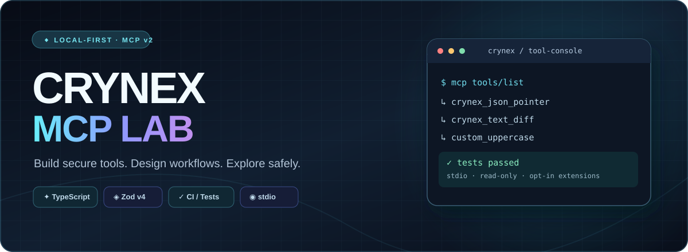
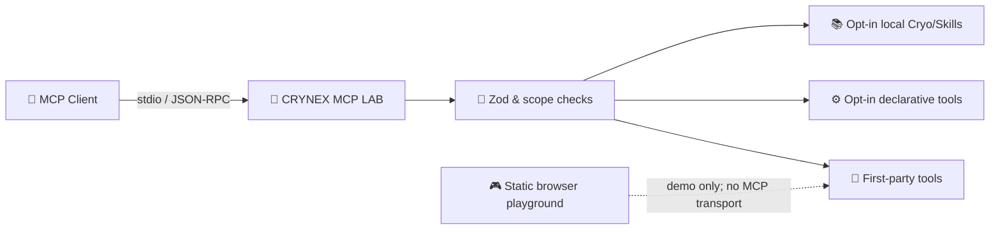

<div align="center">


# CRYNEX MCP LAB

### Your local-first MCP workbench — design · build · validate · explore



[](https://github.com/Pierreg99/CRYNEX-MCP-LAB/actions/workflows/ci.yml)


**No cloud account. No remote execution. No surprise permissions.**

[Quick start](#-quick-start) · [Interactive playground](#-interactive-playground) · [Custom tools](#-mcp-tool-gallery) · [Tool builder](#-build-your-own-tools) · [Architecture](#-architecture) · [Security](#-security) · [Docs](#-documentation)

</div>

---

## ✨ What is CRYNEX?

CRYNEX MCP LAB is an **open, local-first TypeScript Model Context Protocol (MCP) laboratory**. Discover tools, inspect structured responses, create your own safe functions and build MCP-compatible integrations while keeping permissions explicit.

<table>
<tr><td width="50%"><h3>🧩 First-party MCP tools</h3>JSON Pointer, text diff, slug generator and manifest linter — immediately available over stdio.</td><td width="50%"><h3>⚙️ Declarative tool builder</h3>Declare up to 16 extra text transformation tools in a JSON file, no new TypeScript edits required.</td></tr>
<tr><td><h3>🎮 Browser playground</h3>Interactive client-side **demos** and a JSON configuration generator. The page never contacts an MCP process.</td><td><h3>🔒 Permission-aware by default</h3>Network, shell and arbitrary file access are off. Operator-selected catalog, Skills and custom config files are opt-in.</td></tr>
</table>

## 🚀 Quick start

**Requires Node.js 22+ and npm.** The server communicates over **stdio**, so an MCP client manages its process.

```bash
git clone https://github.com/Pierreg99/CRYNEX-MCP-LAB.git
cd CRYNEX-MCP-LAB

npm ci
npm run typecheck
npm test
npm run build

# Interactive MCP Inspector (launches a local MCP process):
npx @modelcontextprotocol/inspector node dist/src/index.js
```

<details>
<summary><b>💻 Configure your MCP desktop client</b></summary>

Adapt this generic `mcpServers` configuration to your client. Use an **absolute** path:

```json
{
  "mcpServers": {
    "crynex-mcp-lab": {
      "command": "node",
      "args": ["/absolute/path/to/CRYNEX-MCP-LAB/dist/src/index.js"]
    }
  }
}
```

The client launches CRYNEX; do not run a second copy as a background service.
</details>

<details>
<summary><b>🐧 Run the local static documentation website</b></summary>

```bash
python3 -m http.server 8080 --directory docs
```

Open **http://localhost:8080** to use the interactive browser-only playground.
The repository does **not** automatically deploy GitHub Pages; the URL is local.
</details>

## 🎮 Interactive playground

<a href="docs/index.html"></a>
The [interactive documentation page](docs/index.html#playground) offers a responsive workspace with real-time **browser-only simulations** for text, JSON and manifests, plus a declarative-tool JSON generator. The page runs entirely in your browser when served locally. **It is not a networked MCP client**: use MCP Inspector above for actual `tools/list` and `tools/call`.

**Try:** select a tool → edit input → press **Run demo** → inspect result → copy it; or open the tool builder → add allowed operations → copy or save your `custom-tools.json`.

## 🧩 MCP tool gallery

| Icon | MCP tool | Description | Availability |
|:---:|---|---|---|
|  | `ping`, `text_stats`, `sha256` | Standard liveness, Unicode text counts and UTF-8 SHA-256 | Always |
|  | `crynex_json_pointer` | Read nested JSON by RFC 6901 pointer | Always |
|  | `crynex_text_diff` | Deterministic bounded line-span comparison | Always |
|  | `crynex_slugify` | Convert text into an ASCII-safe slug | Always |
|  | `crynex_manifest_lint` | Validate a Cryo plugin manifest and show advisory warnings | Always |
|  | `custom_*` | User-defined, allowlisted text transformations | Opt-in |
| 📦 | `cryo_plugin_search` / `cryo_plugin_get` | Read an operator-provided Cryo catalog snapshot | Opt-in |
| 📚 | `cryo_skill_search` / `cryo_skill_get` | Read local Skill snapshots and digests | Opt-in |

The server also exposes MCP Resources such as `crynex://about`, `crynex://tools/custom`, `crynex://tools/configured` (when configured) and the `review-tool-design` Prompt.

<details>
<summary><b>🔍 Sample: extract a nested JSON value</b></summary>

Call `crynex_json_pointer` with:

```json
{
  "document": "{\"items\":[{\"id\":\"demo\"}]}",
  "pointer": "/items/0/id"
}
```

Result (`structuredContent`):

```json
{"found":true,"value":"demo"}
```
</details>

<details>
<summary><b>🔤 Sample: create a clean label</b></summary>

Call `crynex_slugify`:

```json
{"text":"Meine CRYNEX Tools!"}
```

Result: `{"slug":"meine-crynex-tools"}`.
</details>

## ⚙️ Build your own tools

**v0.4.0:** You can define your own *named* MCP tools without compiling new handler code. CRYNEX maps each definition to one of five audited local operations:

| Operation | Behavior |
|---|---|
| `uppercase` | Unicode uppercase conversion |
| `lowercase` | Unicode lowercase conversion |
| `trim` | Remove outer whitespace |
| `slugify` | Build a readable ASCII slug |
| `sha256` | Hash caller-provided text locally |

**1.** Edit [examples/custom-tools.json](examples/custom-tools.json) or generate the file in the [browser tool builder](docs/index.html#tool-builder). Every tool has a valid `custom_*` name, title, description and allowlisted operation.

**2.** Enable the file explicitly when launching the MCP process:

```bash
CRYNEX_CUSTOM_TOOLS_FILE="$(pwd)/examples/custom-tools.json" npm run dev
```

**3.** Inspect `custom_uppercase` in MCP Inspector:

```json
{"text":"Hallo CRYNEX"}
```

Expected structured output: `{"value":"HALLO CRYNEX"}`.

> **Safety boundary:** These declarations are **not executable scripts**. No arbitrary JavaScript, HTTP requests, shell commands or dynamically imported packages are permitted. The file must be an absolute operator-selected path; max 32 KiB, 16 tools, and 10,000 UTF-16 units per request.

<details>
<summary><b>📋 Full custom-tools JSON example</b></summary>

```json
{
  "schemaVersion": 1,
  "tools": [
    {
      "name": "custom_uppercase",
      "title": "Uppercase a message",
      "description": "Convert caller-supplied text to uppercase.",
      "operation": "uppercase"
    }
  ]
}
```
</details>

To add a **new operation implemented in TypeScript**, follow [Custom Tools](docs/CUSTOM-TOOLS.md); to add **a new declarative tool**, follow [Declarative Tools](docs/DECLARATIVE-TOOLS.md).

## 🏗️ Architecture



<details>
<summary><b>🧰 Technical stack and project structure</b></summary>

```text
src/
├── index.ts                 # local stdio startup, opt-in loading
├── server.ts                # MCP tools, prompts and resources
├── config.ts                # trusted operator environment
├── tools/
│   ├── declarative.ts       # strict allowlisted JSON tool builder
│   └── custom/
│       ├── index.ts         # first-party tool registrations
│       └── logic.ts         # pure transformation functions
├── connectors/cryo/        # local catalog and skill snapshots
└── security/policy.ts      # deny-by-default privileges
docs/
├── index.html               # responsive project website
├── playground.css/js       # offline interactive demos and generator
└── assets/                 # SVG branding and tool icons
tests/                      # units and real legacy/modern stdio clients
```
</details>

## 🛡️ Security

- ✅ **Local stdio by default**; no HTTP listener and no arbitrary command execution.
- ✅ **Strict Zod schemas**; bounded input size and no runtime evaluation of config values.
- ✅ **Opt-in paths** for plugin catalog, Skills and declarative tool definitions.
- ✅ **Read-only metadata**; plugin installation and remote execution are not implemented.
- ✅ **CI** on Node.js 22 and 24 with `npm ci`, unit/integration tests and dependency audit.
- ⚠️ Local manifest descriptions and Skill contents remain **untrusted data**, not instructions.
- ⚠️ Browser demos simulate tools locally; they are not a production MCP runtime.

Read the [Security policy](SECURITY.md) and [Threat Model](docs/THREAT-MODEL.md). Tool annotations are descriptive hints, **not authentication**.

## 📚 Documentation

| Guide | Focus |
|---|---|
| [Project website](docs/index.html) | Responsive interactive browser workspace |
| [Declarative tools](docs/DECLARATIVE-TOOLS.md) | JSON schema, configuration and security limits |
| [Custom TypeScript tools](docs/CUSTOM-TOOLS.md) | Extend built-in tools |
| [Cryo integration](docs/CRYO-INTEGRATION.md) | Offline read-only catalog and Skills |
| [Architecture](docs/ARCHITECTURE.md) | Layering and trust boundaries |
| [Protocol support](docs/PROTOCOL-COMPLIANCE.md) | Legacy and modern MCP |
| [Contributing](CONTRIBUTING.md) | Tests and changes |
| [Security](SECURITY.md) | Vulnerability reporting |

## 🗺️ Roadmap

- [x] Working MCP SDK v2 server with stdio and structured schemas
- [x] Read-only Cryo catalog and Skills discovery (operator opt-in)
- [x] Four first-party CRYNEX tools and tests
- [x] Declarative local `custom_*` tool registry
- [x] Interactive browser demo, configuration builder and SVG branding
- [ ] Verified Cryo-OMEGA remote API contract and secure opt-in read-only connector
- [ ] Authenticated HTTP transport, policy audit and tracing
- [ ] Sandboxed, human-approved plugin execution (requires separate security review)

<details>
<summary><b>🌍 Deutsch / Kurzanleitung</b></summary>

**CRYNEX MCP LAB** ist ein lokales TypeScript-Projekt zum Entwickeln und Testen eigener MCP-Funktionen. Mit `npm ci && npm test` testest du den Server. Die interaktive Oberfläche startest du mit `python3 -m http.server 8080 --directory docs` und öffnest **http://localhost:8080**.

**Eigene Tools:** `CRYNEX_CUSTOM_TOOLS_FILE="$(pwd)/examples/custom-tools.json" npm run dev` aktiviert eine kontrollierte Liste von Textoperationen. Es werden keine externen Plugins oder unbekannten Skripte ausgeführt.
</details>

---

<div align="center">
  <sub>Made for exploration. Designed for explicit permissions.</sub>
  <br/>
  <a href="#crynex-mcp-lab">⬆ Back to top</a> ·
  <a href="https://github.com/Pierreg99/CRYNEX-MCP-LAB/issues">💡 Issues / Ideas</a> ·
  <a href="https://github.com/Pierreg99/CRYNEX-MCP-LAB/actions">✅ CI</a>
</div>
